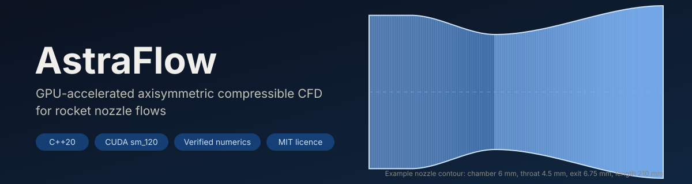
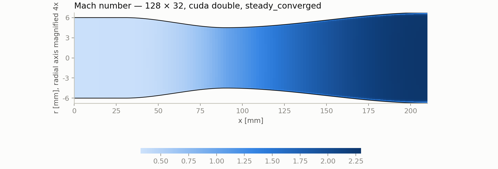
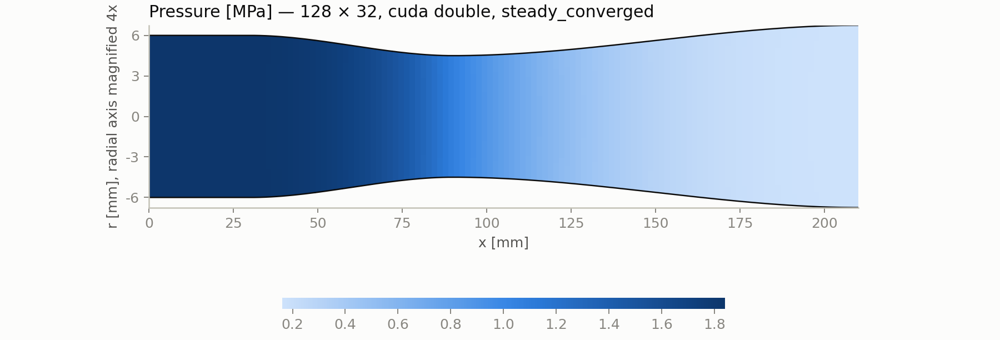
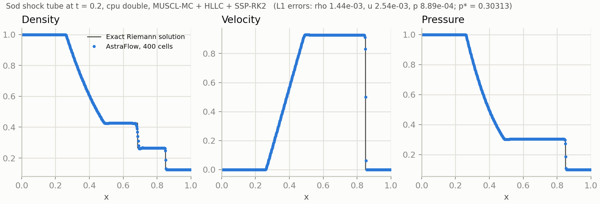
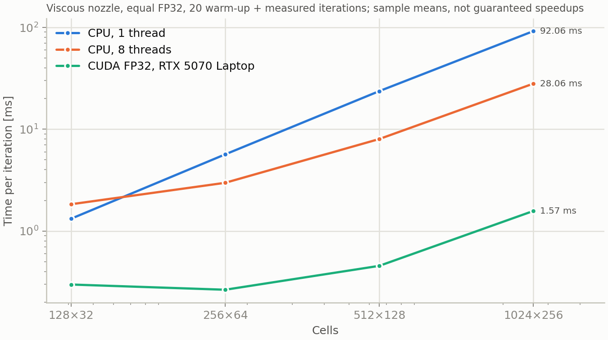
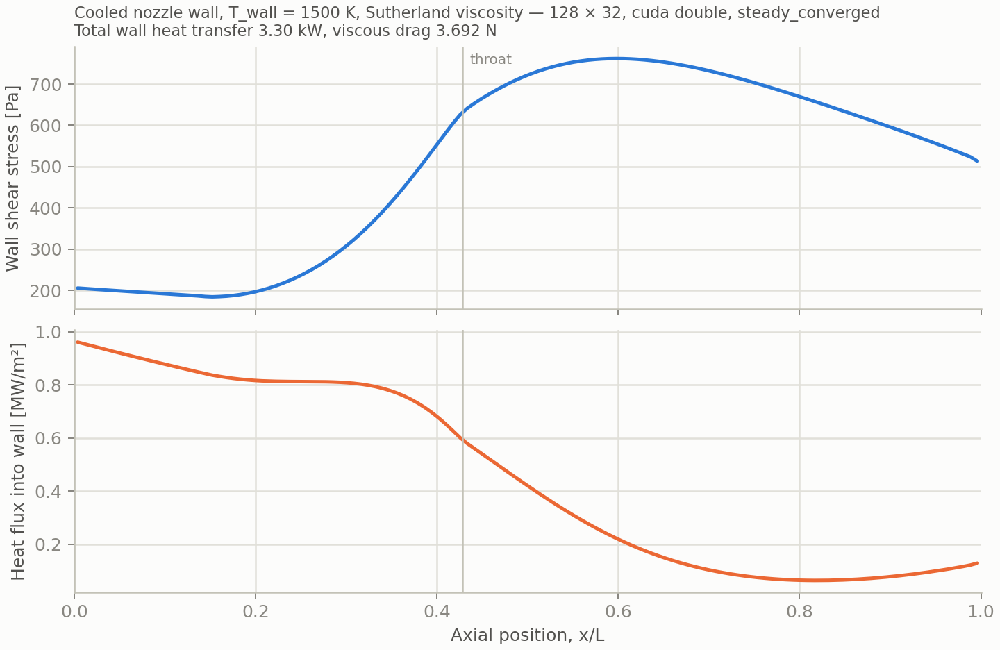
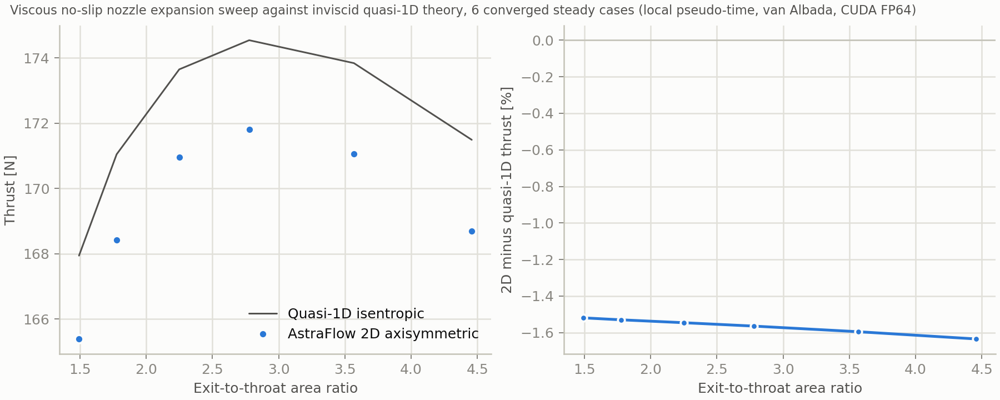
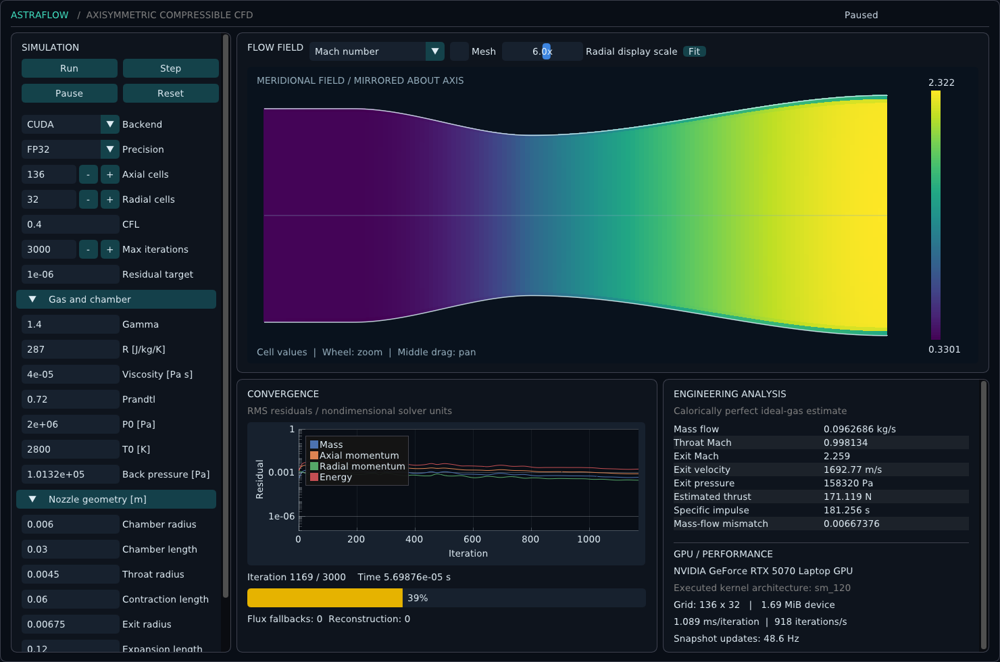
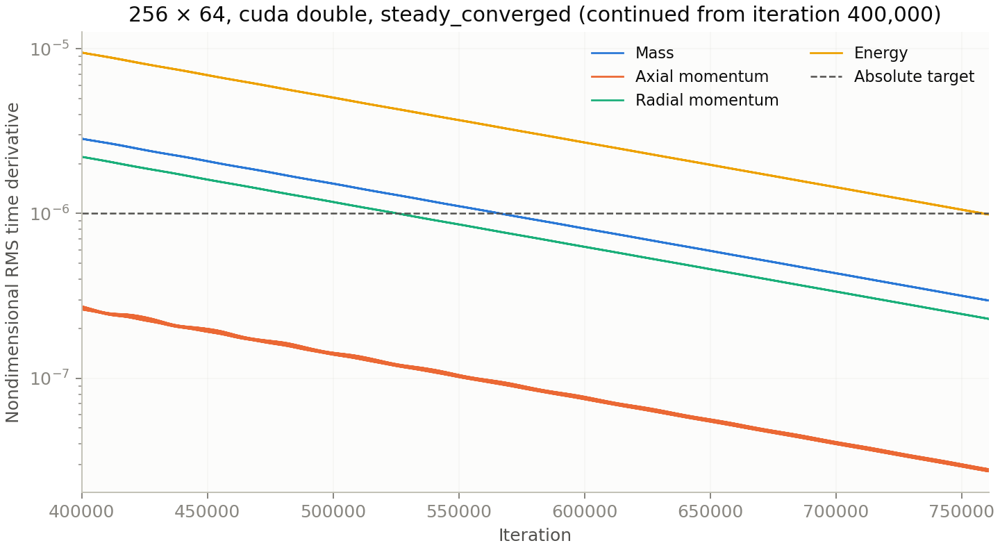
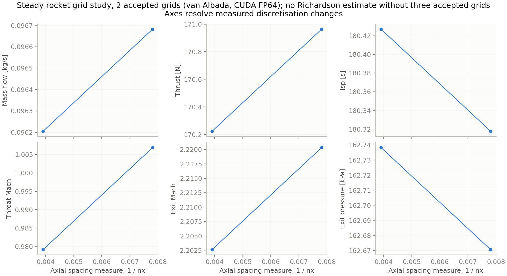

<p align="center">
  
</p>

<p align="center">
  <a href="https://github.com/reverez/AstraFlow/actions/workflows/cpu.yml"></a>
  
  
  
  <a href="LICENSE"></a>
</p>

> **AstraFlow** is a 2D axisymmetric compressible Euler/Navier–Stokes solver written from the governing equations up in **C++20 and NVIDIA CUDA**, with a deterministic CPU reference backend, an analytical verification suite, pre-registered convergence studies, an engineering analysis pipeline, reproducible run artefacts and an interactive GUI. It targets an NVIDIA GeForce RTX 5070 Laptop GPU (Blackwell, compute capability 12.0, `sm_120`).

This is an ongoing research project in verified scientific computing. Every number in this document is a measured result from a preserved run; nothing is estimated or redrawn, and the limits of each claim are stated next to it.

---

## Contents

1. [Status](#status)
2. [Preview](#preview)
3. [Objectives and workflow](#objectives-and-workflow)
4. [Physical model](#physical-model)
5. [Numerical method](#numerical-method)
6. [Verification](#verification)
7. [Rocket nozzle convergence study](#rocket-nozzle-convergence-study)
8. [Engineering analysis and outputs](#engineering-analysis-and-outputs)
9. [Interfaces](#interfaces)
10. [Performance](#performance)
11. [Build and test](#build-and-test)
12. [Architecture](#architecture)
13. [Roadmap](#roadmap)
14. [Scope, integrity and limitations](#scope-integrity-and-limitations)

---

## Status

| Release | Content | State |
|---|---|---|
| **V1.0** (tag `v1.0.0`) | Milestones M0–M9: CPU and CUDA Euler and axisymmetric Navier–Stokes solvers, analytical verification, engineering analysis, CLI and GUI, CUDA profiling, final acceptance | Complete |
| **V1.1** | Scientific closure of the rocket case with the MC limiter: steady convergence monitor, C2b residual investigation, C2c local pseudo-time | Complete as a diagnostic record; medium-grid closure **not** achieved with MC |
| **V1.2** | Pre-registered re-study with the smooth van Albada limiter and the numerical boundary mass gate, three-grid Richardson/GCI, pseudo-time root study | Partially accepted: coarse and medium grids closed, pseudo-time root study passed; the fine grid plateaued at a 5e-6 residual under the pre-registered V1.4 budget and is not accepted |
| **V2.0** | Solver optimisation (one host transfer per CUDA step, solver-side boundary fluxes, OpenMP CPU backend), Sutherland/power-law transport, wall shear and heat-flux analysis, state export/import, nozzle sweep tooling, this document | Complete; see [docs/STATUS.md](docs/STATUS.md) |

Release suites at V2.0: CPU 8/8 CTest entries (37 Catch2 cases), CUDA 10/10, plus 11 Python analysis tests. The V2 executable reproduces the V1.1 executable's 2,000-iteration FP64 rocket field **bitwise**.

---

## Preview

<p align="center">
  
</p>

<p align="center">
  
</p>

<table>
<tr>
<td width="50%"></td>
<td width="50%"></td>
</tr>
<tr>
<td width="50%"></td>
<td width="50%"></td>
</tr>
</table>

<sub>Top: Mach and pressure fields of the accepted 128 × 32 steady state. Bottom left: Sod shock tube against an independent exact Riemann solution, and CPU versus CUDA time per iteration. Bottom right: wall shear and conductive heat flux along a 1500 K isothermal nozzle wall with Sutherland viscosity (steady in 27,640 pseudo-time iterations; 3.30 kW leaves through the wall, which closes the inlet/outlet energy budget of the four-equation balance to 1e-5 relative, peak heat flux 0.96 MW/m², viscous drag 3.69 N), and a six-case expansion sweep where the 2D viscous thrust sits 1.5–1.6% below inviscid quasi-1D theory with mass flow within 0.53%.</sub>

<p align="center">
  <br>
  <sub>Actual framebuffer capture of the interactive application: nozzle flow, live residual history, engineering results and CUDA telemetry. Radial display magnification is labelled and does not modify the geometry.</sub>
</p>

---

## Objectives and workflow

AstraFlow follows the complete path from a continuous physical model to verified high-performance numerical software:

1. implement the governing equations rather than wrap an existing CFD package;
2. construct a conservative finite-volume method for transonic and supersonic internal flow;
3. reproduce characteristic rocket-nozzle behaviour and quantify its discretisation uncertainty;
4. verify every ingredient against analytical solutions, conservation and convergence order;
5. keep CPU and CUDA backends that cross-validate to round-off;
6. exploit the GPU and measure, rather than assume, the speed-up;
7. expose the solver through a reproducible CLI, a study runner and an interactive GUI.

### Architect-directed, AI-assisted implementation

I am responsible for the physical scope, governing equations, conservative state representation, discretisation, reconstruction and Riemann solver choices, temporal integration, axisymmetric formulation, boundary conditions, verification cases and tolerances, the CPU/CUDA parity strategy, the software and CUDA architecture, milestone gates and the interpretation of every result. AI coding agents accelerate implementation, tests, debugging, profiling and documentation under those specifications.

```text
Mathematical architecture → implementation specification → AI-assisted implementation
        → numerical verification → architectural review → milestone acceptance
```

Generated code is accepted only after comparison against analytical solutions, conservation properties, convergence behaviour or CPU/GPU parity. Compiling and producing plausible flow fields is not acceptance. Study criteria are written down before a run starts and are never relaxed after a result is seen; a criterion believed to be wrong is replaced by a new pre-registered study, not edited in place.

---

## Physical model

A single-species, calorically perfect ideal gas flows through an axisymmetric converging–diverging nozzle. The conservative state is

```math
\mathbf{U}=\begin{bmatrix}\rho\\ \rho u\\ \rho v\\ \rho E\end{bmatrix},\qquad
\frac{\partial \mathbf{U}}{\partial t}+\nabla\cdot\mathbf{F}_c-\nabla\cdot\mathbf{F}_v=\mathbf{S},
```

with convective flux $\mathbf{F}_c$, viscous and thermal flux $\mathbf{F}_v$ and the axisymmetric geometric source $\mathbf{S}$. Mass, momentum and energy read

```math
\partial_t\rho+\nabla\cdot(\rho\mathbf{u})=0,\qquad
\partial_t(\rho\mathbf{u})+\nabla\cdot(\rho\mathbf{u}\otimes\mathbf{u}+p\mathbf{I}-\boldsymbol{\tau})=\mathbf{S}_m,
```
```math
\partial_t(\rho E)+\nabla\cdot\big[(\rho E+p)\mathbf{u}-\boldsymbol{\tau}\cdot\mathbf{u}+\mathbf{q}\big]=S_E,\qquad
\mathbf{q}=-k\nabla T .
```

Closures: $p=(\gamma-1)\rho e$, $a=\sqrt{\gamma p/\rho}$, $k=\mu c_p/\mathrm{Pr}$. The dynamic viscosity is constant, Sutherland

```math
\mu=\mu_{\mathrm{ref}}\left(\frac{T}{T_{\mathrm{ref}}}\right)^{3/2}\frac{T_{\mathrm{ref}}+S}{T+S},
```

or a power law $\mu=\mu_{\mathrm{ref}}(T/T_{\mathrm{ref}})^n$. Reacting chemistry, multi-species transport, turbulence and real-gas thermodynamics are deliberately outside the model.

### Geometry and boundary conditions

The meridional $(x,r)$ plane of a rotationally symmetric nozzle is parameterised by chamber radius and length, throat radius, contraction length, exit radius and expansion length; a structured body-conforming grid follows the $C^1$ contour and the finite-volume formulation treats the centreline $r\to0$ explicitly.

| Boundary | Treatment |
|---|---|
| Centreline | Axisymmetric symmetry: $\rho,u,p$ even, $v$ odd; zero cylindrical face area |
| Inviscid wall | Reflected normal velocity, retained tangential velocity (slip, impermeable) |
| Viscous wall | No-slip, impermeable; adiabatic (tangentially projected heat gradient) or isothermal at a prescribed wall temperature |
| Inlet | Reservoir stagnation state $P_0,T_0$ with the outgoing acoustic invariant retained; subsonic reservoir-fed inflow only |
| Outlet | Static back pressure where the outflow is subsonic; full extrapolation where it is supersonic |

---

## Numerical method

**Cell-centred conservative finite volumes** on a structured body-conforming grid, with a structure-of-arrays state:

```math
\frac{d\mathbf{U}_i}{dt}=-\frac{1}{V_i}\sum_f\mathbf{F}_fA_f+\mathbf{S}_i .
```

| Ingredient | Choice |
|---|---|
| Reconstruction | MUSCL on primitive variables with minmod, van Leer, MC or **van Albada** slope limiters (V2); MC is the V1 baseline, van Albada the V1.2 study scheme |
| Convective flux | HLLC in the rotated face frame with Davis wave bounds; conservative HLLE fallback when an intermediate state is nonphysical, counted and reported, never silent |
| Viscous flux | Central transport gradients mapped to physical coordinates, face averages corrected along the centre-to-centre vector (controls non-orthogonal diffusion), cylindrical hoop stress in the radial source |
| Time integration | Second-order SSP Runge–Kutta with a CFL condition that combines the convective bound and the diffusive bound $D=\max(4\mu/3\rho,\ \mu\gamma/\mathrm{Pr}\rho)$ harmonically; optional **local pseudo-time RK2** with the identical spatial operator for steady acceleration |
| Precision | FP32 and FP64 on both backends; the problem is internally nondimensionalised by throat radius, $P_0$, $T_0$ and $\sqrt{RT_0}$ |
| Determinism | `-ffp-contract=off` and `--fmad=false` so CPU and CUDA round identically; FP64 parity is 1e-14–1e-15 |

The 2D numerics are header-only templates instantiated for `float` and `double` on **both** backends: `src/cpu/solver.cpp` and `src/cuda/solver.cu` call the same reconstruction, boundary, flux, source and timestep functions and differ only in scheduling and memory. That is what makes parity a meaningful test rather than a coincidence.

Details: [governing equations](docs/mathematics/governing_equations.md) · [numerical method](docs/mathematics/numerical_method.md) · [axisymmetric formulation](docs/mathematics/axisymmetric_navier_stokes.md) · [boundary conditions](docs/mathematics/boundary_conditions.md).

---

## Verification

All bounds were fixed before the corresponding test was first run. Full tables, definitions and the reproducible sanitizer command are in the [verification report](docs/verification/verification_report.md).

### Analytical and conservation checks

| Case | Measured | Bound |
|---|---:|---:|
| Sod shock tube, 400 cells, MC: L1 error in $\rho$ / $u$ / $p$ | 1.45e-3 / 2.55e-3 / 8.9e-4 | 6e-3 / 8e-3 / 5e-3 |
| Sod shock tube, 400 cells, van Albada: L1 error in $\rho$ / $u$ / $p$ | 1.83e-3 / 3.33e-3 / 1.22e-3 | same |
| Sod total mass drift | 3.3e-15 | 1e-12 |
| 2D periodic transport: each conserved integral | ≤ 1e-12 | 1e-12 |
| Smooth entropy wave, observed L1 order (MC / van Albada) | 1.81, 2.00 / 1.61, 1.94 | > 1.5 |
| Axisymmetric nozzle: throat Mach, mean Mach difference from quasi-1D | 1.0096, 3.2e-4 | 0.85–1.15, 0.12 |
| Compressible Couette, constant $\mu$: velocity / temperature L1 | 5.1e-5 / 4.5e-5 | 2e-3 / 1e-3 |
| Couette temperature observed order (12 → 24 → 48 cells) | 2.00, 2.00 | > 1.7 |
| Compressible Couette, Sutherland $\mu(T)$: velocity / temperature L1 | 2.3e-5 / 1.2e-4 | 2e-3 / 1e-3 |
| Compressible Couette, power-law $\mu(T)$: velocity / temperature L1 | 2.8e-5 / 1.2e-4 | 2e-3 / 1e-3 |
| Couette wall shear, conductive heat flux = half the dissipation | 2e-3, 2e-5 relative | 2e-3, 1e-3 |
| Isothermal nozzle wall: integrated heat transfer vs balance energy flux | 1e-10 relative | 1e-10 |

The variable-viscosity Couette case uses the fact that the exact steady solution exists for *any* $\mu(T)$: the energy equation gives $T(u)=T_w+\mathrm{Pr}\,u(U-u)/2c_p$ independently of the viscosity law, and $y(u)=\tau^{-1}\int_0^u\mu(T(s))\,ds$ is evaluated by quadrature inside the test.

### CPU / CUDA parity (maximum conservative difference)

| Case | FP64 | FP32 |
|---|---:|---:|
| 1D Sod, 400 cells | 4.2e-14 | 4.6e-6 |
| 2D periodic transport | 1.8e-15 | — |
| Axisymmetric nozzle, 100 steps | 4.9e-15 | — |
| Viscous nozzle, 100 steps | 4.0e-15 | 4.3e-6 |
| Isothermal-wall Sutherland nozzle, 100 steps | 3.6e-15 | — |
| Local pseudo-time nozzle, 100 iterations | < 2e-12 | — |
| Independent 82,480-iteration rocket integration (V1.1) | 1.2e-14 | — |

Backend invariants added in V2: solver-side numerical boundary mass fluxes agree between CPU and CUDA to 1e-12 and with the host finite-volume balance to 1e-14; CPU fields, residuals and boundary sums are bitwise identical between one and eight OpenMP threads.

---

## Rocket nozzle convergence study

The rocket case is a 210 mm converging–diverging nozzle (chamber 6 mm, throat 4.5 mm, exit 6.75 mm radius) fed at $P_0=2$ MPa, $T_0=2800$ K into 101325 Pa ambient, $\gamma=1.4$, $R=287$ J/(kg K), $\mu=4\times10^{-5}$ Pa s, Pr = 0.72, stationary adiabatic no-slip wall, integrated in CUDA FP64.

### What V1.1 established (MC limiter)

The 128 × 32 case reaches `steady_converged` at 82,480 iterations with every residual below 1e-6 and engineering observables stable to 1.8e-8 over a 2,000-iteration window; an independent CPU FP64 integration reproduces the field to 1.2e-14. The 256 × 64 case stalls at an energy residual of ~1e-4 for 250,000 iterations. The [C2b investigation](docs/verification/residual_closure_c2b.md) showed that this is **not** a conservation or assembly defect: the true inlet/outlet numerical mass-flux mismatch is 1.3e-7 and every four-equation balance assembles to round-off. The dominant residual cells reverse sign hundreds of times in step with MC limiter branch switches at near-axis cells, and the oscillation is strongly reduced under smoother reconstruction. [C2c](docs/verification/steady_acceleration_c2c.md) found that local pseudo-time reaches the same stopping rule 1.45× faster but rejected it against a 1e-8 field bound at a 1e-6 residual tolerance, a bound that a finite stopping tolerance cannot deliver. Those gates were left exactly as recorded; see the [V1.1 closure report](docs/verification/rocket_scientific_closure.md).

### V1.2: pre-registered re-study

The [V1.2 protocol](docs/verification/v12_closure_protocol.md) was committed before any run: the smooth van Albada limiter with every other ingredient unchanged, the numerical boundary mass-flux mismatch (≤ 1e-6) replacing the first-order interior-cell estimate as the mass gate, unchanged residual (1e-6), window and station-spread gates, iteration caps fixed in advance, and a pseudo-time root study that reads agreement from how the physical/pseudo field difference scales with the stopping tolerance rather than from one fixed bound.

#### Results (V1.2 and V1.3; full tables in [rocket_closure_v12.md](docs/verification/rocket_closure_v12.md))

| Grid | Scheme | Iterations | Termination | Final residuals (mass, x-mom, r-mom, energy) | Numerical mass mismatch |
|---|---|---:|---|---|---:|
| 128 × 32 | MC (V1.1) | 82,480 | `steady_converged` | 2.6e-7, 3.1e-8, 2.0e-7, 8.6e-7 | 9.5e-10 |
| 128 × 32 | van Albada | **49,480** | `steady_converged` | 2.5e-7, 2.8e-8, 1.9e-7, 8.2e-7 | 3.2e-9 |
| 256 × 64 | MC (V1.1) | 250,000 | `iteration_limit`, plateau | 3.4e-5, 1.6e-5, 2.7e-5, 1.1e-4 | 1.3e-7 |
| 256 × 64 | van Albada | **760,760** | `steady_converged` | 3.0e-7, 2.8e-8, 2.3e-7, 9.9e-7 | 1.1e-9 |
| 512 × 128 | van Albada | 7,000,000 (cap) | `iteration_limit`, plateau | 1.5e-6, 3.8e-7, 1.7e-6, 5.0e-6 | 3.1e-9 |

- **The medium rocket grid converged for the first time.** Under van Albada the residual decays as a single exponential over 760k iterations with no plateau, which is what the limiter-switching hypothesis predicted; the MC history stalls at 1e-4.
- **CPU/CUDA FP64 cross-check on 128 × 32:** both backends terminate at iteration 49,480 with a maximum nondimensional conservative-field difference of 1.3e-14.
- **Pseudo-time root study:** physical-time and local pseudo-time endpoints differ by 1.6e-6, 5.1e-7 and 1.6e-7 in Linf at tolerances 1e-6, 3e-7 and 1e-7 (ratio 10.2, monotone). They converge to the same discrete root; pseudo-time needs about half the iterations.
- **Grid change coarse → medium:** mass flow 0.50%, thrust 0.44%, Isp 0.06%, exit pressure 0.04%, exit Mach 0.8%. Richardson extrapolation and GCI need the third grid and are not reported.
- **Fine grid:** the [V1.4 continuation](docs/verification/v14_fine_continuation_protocol.md) took the 512 × 128 trajectory to 7.0M iterations. The energy residual stopped at 5.0e-6 (mass and radial momentum at 1.5 to 1.7e-6) while the observables were stationary to nine figures, so the grid is **not accepted** and no Richardson/GCI estimate is reported. That floor is five to twenty times below the MC plateau of V1.1, but it is a plateau; diagnosing it is the next study.

<p align="center">
  
</p>
<p align="center">
  
</p>

---

## Engineering analysis and outputs

From the physical snapshot the analysis integrates mass flow at every axial station, the exit state (area- or mass-weighted Mach, velocity, pressure, temperature), thrust

```math
F=\int_{A_e}\rho u^2\,dA+\int_{A_e}(p-p_a)\,dA,\qquad I_{sp}=\frac{F}{\dot m g_0},
```

the true four-equation boundary/source balance, and, for viscous no-slip cases, the wall traction and conductive heat flux on every wall face with integrated viscous drag and heat-transfer rate. These describe the idealised ideal-gas model, not certified engine performance.

Every run writes a self-describing directory; explicit output paths must be new or empty, and `scripts/check_run.py` validates the structure with the standard library only.

```text
runs/<run-id>/
├── config.json           effective configuration        ├── summary.json        engineering results, convergence report, termination
├── metadata.json         sampling semantics, version    ├── performance.json    wall/solver time, device memory, reference scales
├── convergence.csv       residual history               ├── final_balance.json  four-equation boundary/source balance
├── engineering.csv       sampled observables            ├── wall.csv            wall traction, heat flux, pressure (viscous no-slip)
├── mesh.vts / final_state.vts   VTK StructuredGrid for ParaView
```

Residuals are RMS time derivatives in nondimensional solver units; fields, times and engineering results use configuration units (SI in the rocket examples). Each run records whether it terminated by convergence, end time, iteration limit, user stop or an invalid state.

---

## Interfaces

**CLI**

```bash
./build/astraflow_cli --config examples/rocket_nozzle/config.json --backend cuda \
    [--precision float|double] [--output runs/my-rocket] [--max-iterations N] \
    [--initial-state state.json] [--write-state state.json] [--threads N]
./build/astraflow_cli --device-info      # executes a kernel and reports the compiled architecture
./build/astraflow_cli --version
```

Examples: [Sod](examples/sod/config.json), [isentropic nozzle](examples/isentropic_nozzle/config.json), [viscous Couette channel](examples/viscous_channel/config.json), [viscous rocket nozzle](examples/rocket_nozzle/config.json), the [V1.1](examples/rocket_nozzle/scientific_closure.json) and [V1.2](examples/rocket_nozzle/v12_closure.json) study presets and a [cooled-wall nozzle](examples/rocket_nozzle/cooled_wall.json) with Sutherland transport and an isothermal 600 K wall.

**Study drivers** (`scripts/`): `run_scientific_closure.py` (sequential, lock-protected, checksum-verified grid study), `analyze_scientific_closure.py` (window statistics, Richardson/GCI, CPU/CUDA comparison), `run_pseudo_root_study.py`, `sweep_nozzle.py` (expansion-ratio sweep against quasi-1D theory), `plot_scientific_closure.py` and `plot_readme_figures.py` (every figure here is generated from preserved outputs).

**GUI** (Dear ImGui, ImPlot, GLFW, OpenGL): Run, Pause, Single Step, Reset and Regenerate Mesh on the same solver as the CLI; nine visualisable fields; convergence, chamber, geometry, engineering, CUDA device and performance panels. A `std::jthread` worker owns the simulation and publishes immutable snapshots, so the renderer never touches live CUDA memory. `--smoke-test --capture out.ppm` drives every control and captures the framebuffer for verification.

---

## Performance

Measured on the RTX 5070 Laptop GPU and an Intel Core Ultra 9 285H, equal FP32, viscous nozzle, 20 warm-up and 50 measured iterations, sample means. The V1.1 and V2 executables were run alternately in the same machine state. Full methodology and raw samples: [benchmark report](docs/performance/benchmark_report.md).

| Grid | Cells | CPU 1 thread | CPU 8 threads | CUDA (V1.1) | CUDA (V2) | V2 CPU-1 / CUDA |
|---|---:|---:|---:|---:|---:|---:|
| 128 × 32 | 4,096 | 1.59 ms | 1.74 ms | 0.363 ms | **0.220 ms** | 7.2× |
| 256 × 64 | 16,384 | 6.87 ms | 3.16 ms | 0.447 ms | **0.242 ms** | 28× |
| 512 × 128 | 65,536 | 29.9 ms | 8.69 ms | 0.554 ms | **0.339 ms** | 88× |
| 1024 × 256 | 262,144 | 120 ms | 30.4 ms | 1.806 ms | 1.868 ms | 64× |

V2 removed three of the four host synchronisations per CUDA step (the RK kernels read the reduced timestep on the device, and one diagnostics record carries residual sums, boundary fluxes, invalid-state index and fallback counters), which is why launch-bound grids gain 38–45% while the bandwidth-bound 1024 × 256 case is unchanged. Moving the numerical boundary mass-flux sums into the solver cut the end-to-end time of the FP64 scientific configuration from 2.85 s to 1.22 s per 2,000 iterations. These are not comparisons against a tuned multicore CPU code, and the eight-thread figures require a passive OpenMP wait policy and core binding on this hybrid-core WSL2 host (the default spin-wait was 20× slower than serial).

---

## Build and test

Requirements: CMake ≥ 3.24, Ninja, a C++20 compiler (tested GCC 13.3), CUDA 12.8+ for the GPU backend (tested 12.8.93, Ubuntu 24.04 on WSL2). Pinned dependencies (nlohmann/json 3.11.3, Catch2 3.7.1, Dear ImGui 1.91.8, ImPlot 0.16, GLFW 3.4) are fetched at first configure. No Python packages are required except Matplotlib for figures.

```bash
# CPU reference build (what CI runs)
cmake -S . -B build-cpu -G Ninja -DCMAKE_BUILD_TYPE=Release -DASTRAFLOW_ENABLE_CUDA=OFF
cmake --build build-cpu -j8 && ctest --test-dir build-cpu --output-on-failure

# CUDA build with a project-local toolchain (no system CUDA installation needed)
python3 -m venv .venv && .venv/bin/python scripts/bootstrap_cuda.py      # SHA256-checked NVIDIA packages
cmake -S . -B build -G Ninja -DCMAKE_BUILD_TYPE=Release -DASTRAFLOW_ENABLE_CUDA=ON \
      -DCMAKE_CUDA_COMPILER="$PWD/.toolchains/cuda-12.8.1/bin/nvcc" -DCMAKE_CUDA_ARCHITECTURES=120
cmake --build build -j8 && ctest --test-dir build --output-on-failure

# Optional
-DASTRAFLOW_BUILD_GUI=ON          # bash scripts/bootstrap_gui.sh first if X11/OpenGL headers are missing
-DASTRAFLOW_BUILD_BENCHMARKS=ON   # astraflow_benchmark and the residual/closure diagnostics
-DASTRAFLOW_ENABLE_OPENMP=OFF     # single-thread-only CPU backend
```

Single tests: `ctest --test-dir build -R nozzle_verification`, `./build/astraflow_tests "[viscous]"` or by case name. The CPU AddressSanitizer/UndefinedBehaviorSanitizer configuration used for acceptance is recorded in the verification report. CPU-only GitHub Actions also enforces `clang-format` and validates a Sod run end to end; GPU verification runs locally on the target hardware.

---

## Architecture

```text
physics/state.hpp ─▶ numerics/{flux, finite_volume}.hpp ─▶ cpu/ · cuda/ ─▶ core/Simulation ─▶ analysis/ · io/ ─▶ apps/{cli, gui}
```

| Layer | Responsibility |
|---|---|
| `physics` | Ideal-gas conversions, transport models, SoA state view; `__host__ __device__` templates |
| `numerics` | Limiters, rotated HLLC/HLLE, boundary ghost states, MUSCL slopes, corrected viscous gradients, residual with cylindrical source, CFL bound |
| `cpu`, `cuda` | Scheduling and memory only: OpenMP loops with serial fixed-order reductions; RAII device buffers, CUB reductions, one host transfer per step, no allocations in the loop |
| `core` | `Simulation` (nondimensionalisation, backend selection, convergence monitor, termination), `Controller` (GUI worker thread) |
| `analysis` | Engineering integrals, steady convergence monitor, four-equation balance, wall loads, GUI fields |
| `io` | Strict JSON configuration (unknown keys are errors), run directories, hand-written VTK, state export/import |
| `apps` | CLI and ImGui GUI; numerical physics is never implemented in GUI code |

Dependency direction is strictly downward. See the [architecture overview](docs/architecture/overview.md) and the [environment record](docs/environment.md).

---

## Roadmap

| Milestone | Scope | State |
|---|---|---|
| M0–M9 | Toolchain, 1D Euler, CUDA Euler, 2D finite volumes, axisymmetric nozzle, viscous Navier–Stokes, analysis and CLI, GUI, profiling, final verification | Complete (`v1.0.0`) |
| C0–C2 | Convergence monitor, 128 × 32 steady closure, CPU cross-check | Complete |
| C3–C6 | 256 × 64 / 512 × 128 closure, Richardson/GCI, figures, acceptance with the MC limiter | Blocked by the MC limit cycle; C2b/C2c diagnostics complete |
| V1.2 | Van Albada re-study under pre-registered criteria | Partially accepted: coarse and medium grids closed, pseudo-time root study passed; the fine grid plateaued at a 5e-6 residual under the pre-registered V1.4 budget and is not accepted |
| V2.0 | Optimisation, transport models, wall analysis, tooling, documentation | Complete |
| Next | External plume with far-field boundaries, real-gas thermodynamics, multi-species reacting flow, turbulence modelling, conjugate wall heat transfer, CUDA/OpenGL interoperability, multi-GPU, three-dimensional geometry | Planned; each arrives with its own verification case |

Phase 2 physics that cannot yet be verified to this project's standard (chemistry, turbulence, plumes, real gas) is intentionally not included; adding an unverified model would weaken every number above.

---

## Scope, integrity and limitations

- Quantitative verification rather than visual validation; CPU/CUDA cross-checking; physically justified, pre-registered tolerances; explicit invalid-state detection; measured rather than assumed performance; preservation of verification after every optimisation.
- No claim of fidelity beyond the implemented model: single-species calorically perfect gas, laminar, axisymmetric, no plume, no chemistry, no turbulence, no real-gas effects. Grid convergence of the nozzle calculation is a statement about the discretisation, not experimental validation of a rocket engine.
- Nsight Systems, Nsight Compute and compute-sanitizer were unavailable in this environment; no result from those tools is claimed.
- AstraFlow numerically solves a discretised compressible Euler/Navier–Stokes model and makes no claim regarding the mathematical Navier–Stokes existence-and-smoothness problem.
- This is an educational, research and portfolio project. It is not flight-qualified aerospace software and must not be the sole basis for safety-critical design, manufacture or operation.

---

## Author and licence

**Arnav** — BSc Computer Science with Artificial Intelligence, University of Nottingham. Mathematical formulation, numerical-method and CFD system design, CUDA and software architecture, verification strategy, technical review and direction of the AI-assisted implementation.

AstraFlow is released under the [MIT Licence](LICENSE). Third-party libraries retain their upstream licences; NVIDIA CUDA and associated tooling remain subject to NVIDIA's licence terms.
