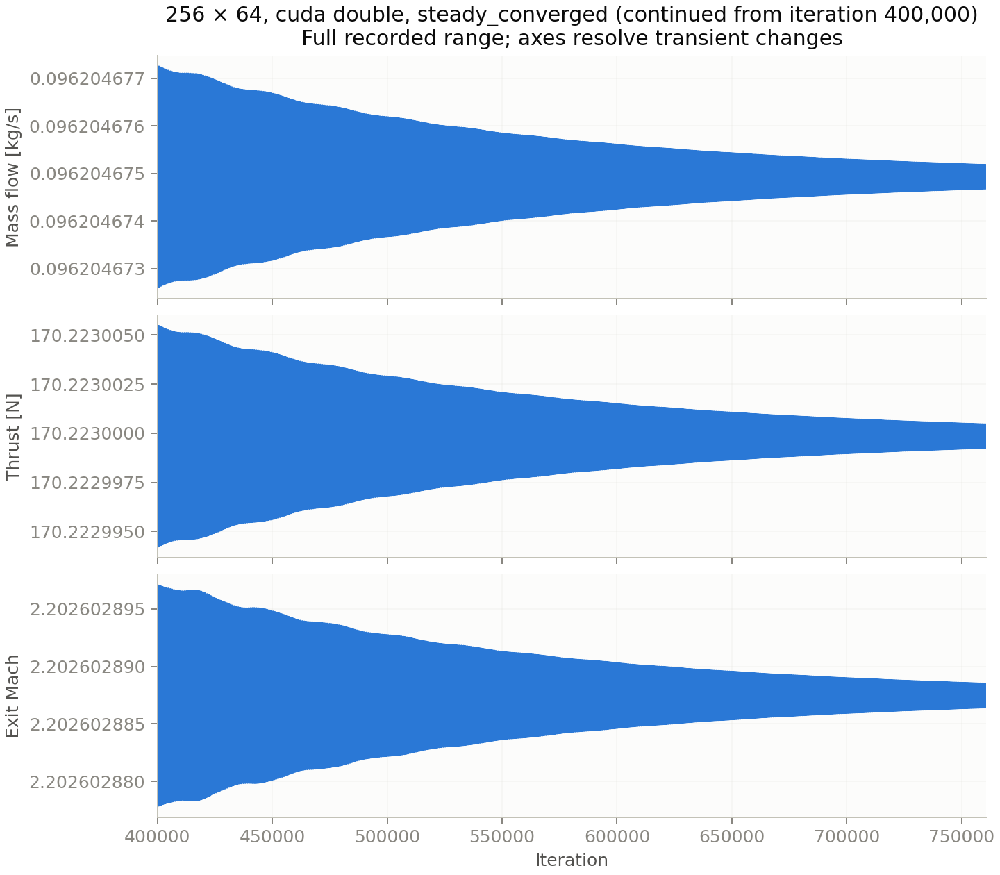
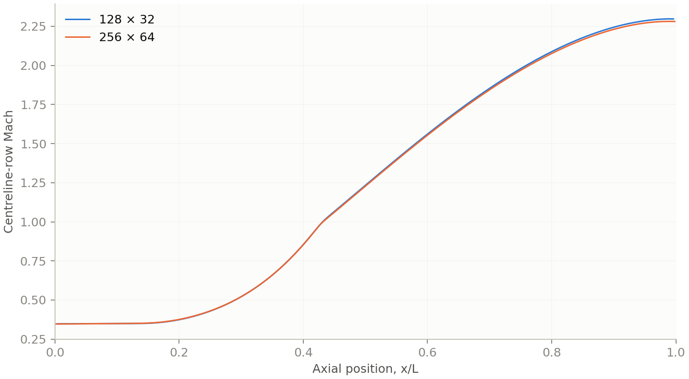
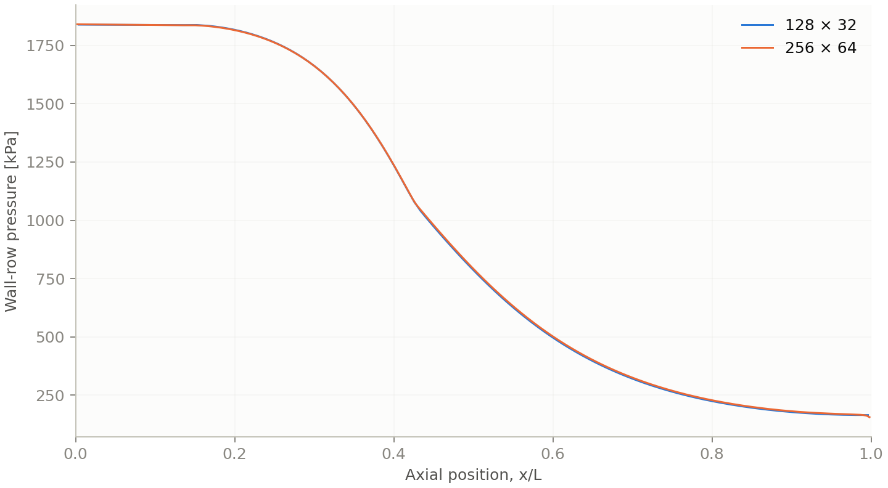

# Rocket closure — V1.2 and V1.3 results

Protocols: [V1.2](v12_closure_protocol.md) (committed before any run) and
[V1.3 continuation](v13_continuation_protocol.md) (committed at V1.2 medium iteration 216,180).
Every number here is read from preserved run directories by `scripts/analyze_scientific_closure.py`,
`scripts/run_pseudo_root_study.py analyze` and `scripts/run_v13_continuation.py`; nothing was
rerun to regenerate a figure. Configuration: `examples/rocket_nozzle/v12_closure.json` (van Albada,
CUDA FP64, numerical boundary mass gate 1e-6, all other gates as V1.1). Executable commit
`81caf65` (SHA256 recorded in each provenance file).

## V1.2 outcomes against the pre-registered acceptance

| Item | Pre-registered requirement | Outcome |
|---|---|---|
| 128×32 steady closure | `steady_converged`, zero fallbacks | **Pass**: 49,480 iterations, 35.1 s wall, 0/0 fallbacks |
| 256×64 steady closure under the 400,000 cap | `steady_converged` | **Fail (cap)**: `iteration_limit` at 400,000 with residuals [2.84e-6, 2.63e-7, 2.21e-6, 9.46e-6], still decaying exponentially; see V1.3 |
| 512×128 | `steady_converged` under 1,000,000 | **Not launched** (sequence stops after a failed grid) |
| CPU FP64 cross-check, 128×32 | same termination iteration, max field difference ≤ 1e-10 | **Pass**: 49,480 iterations on both backends, max difference 1.29e-14 |
| Pseudo-time root study (H2) | Linf difference decreases monotonically with tolerance, ratio Linf(1e-6)/Linf(1e-7) ≥ 3 | **Supported**: 1.62e-6 → 5.06e-7 → 1.59e-7, ratio 10.2 |
| Richardson/GCI | three accepted grids | Deferred to V1.3 |

V1.2 is therefore **partially accepted** exactly as its protocol defines partial outcomes. The
medium-grid budget was a planning error: the van Albada scheme shows no plateau, only a slower
late decay than the cap allowed for. The cap was not raised inside V1.2.

## Accepted 128×32 state (V1.2, reused by V1.3)

Convergence window iterations 47,480–49,480 (101 samples). Initial residuals (first completed
step) [4.79e-4, 1.26e-3, 1.17e-3, 1.68e-3]; final [2.47e-7, 2.82e-8, 1.88e-7, 8.20e-7].

| Quantity | V1.2 van Albada | V1.1 MC (82,480 it.) | Relative difference |
|---|---:|---:|---:|
| Mass flow (kg/s) | 0.09668183 | 0.09668439 | 2.6e-5 |
| Throat Mach | 1.006881 | 1.006771 | 1.1e-4 |
| Exit Mach | 2.220332 | 2.217706 | 1.2e-3 |
| Exit pressure (Pa) | 162,670.6 | 162,795.2 | 7.7e-4 |
| Exit temperature (K) | 1413.30 | 1411.76 | 1.1e-3 |
| Thrust (N) | 170.9636 | 171.0077 | 2.6e-4 |
| Specific impulse (s) | 180.3176 | 180.3593 | 2.3e-4 |
| Numerical boundary mass mismatch | 3.2e-9 | 9.5e-10 | — |
| Interior-cell mass estimate mismatch | 3.88e-5 | 3.52e-5 | — |
| Station spread | 4.37e-4 | 4.47e-4 | — |

Window relative ranges: mass flow 7.6e-9, thrust 1.0e-8, Isp 2.8e-9, throat Mach 4.3e-9, exit
Mach 1.4e-9, exit pressure 7.1e-9 (all ≤ 5e-4). The two limiters agree on the same grid to
≤ 1.2e-3 on every primary quantity, which is the size of the reconstruction difference at this
resolution; neither is "more correct" without the grid study below.

## Pseudo-time root study (128×32)

Physical SSP-RK2 and local pseudo-time RK2 (steady CFL 0.4) integrated from the same initial
state to the same monitor at three tolerances. Field norms are nondimensional conservative
differences between the two endpoints, all cells, all four components.

| Tolerance | Physical iterations | Pseudo iterations | Linf (all components) | Max primary engineering relative difference |
|---|---:|---:|---:|---:|
| 1e-6 | 49,480 | 25,520 | 1.615e-6 | 5.6e-9 |
| 3e-7 | 61,500 | 30,220 | 5.057e-7 | 1.1e-9 |
| 1e-7 | 72,520 | 34,580 | 1.586e-7 | 3.0e-10 |

The difference scales almost exactly with the tolerance (ratio 10.2 over one decade), which is
the pre-registered signature of two integrations approaching the same discrete root at different
rates. This resolves the open question left by C2c: the 2.8e-6 difference it rejected at a 1e-6
tolerance was the expected finite-tolerance residue, not evidence of distinct roots. Pseudo-time
needs about half the iterations; each pseudo iteration costs three spatial evaluations against
two, so the measured wall-time ratios (0.92, 2.12, 1.48, physical over pseudo) are dominated by
laptop load variance during the campaign and are not reported as an acceleration factor. The
accepted study integrator remains physical time; pseudo-time is an acceleration option whose
endpoint agrees with it to the tolerance.

## V1.3: medium continuation and fine grid

<!--V13RESULTS-->

## Grid study, Richardson analysis and GCI

<!--V13GRID-->

## Figures

Generated from the preserved runs by `scripts/plot_scientific_closure.py runs/v13-closure`.

## Limitations

Grid convergence of this laminar ideal-gas calculation measures discretisation error only. It is
not experimental validation and says nothing about turbulence, chemistry, real-gas effects or the
plume, none of which are modelled. The V1.1 MC results are preserved unchanged; the V1.2 scheme is
a different discretisation of the same equations.
