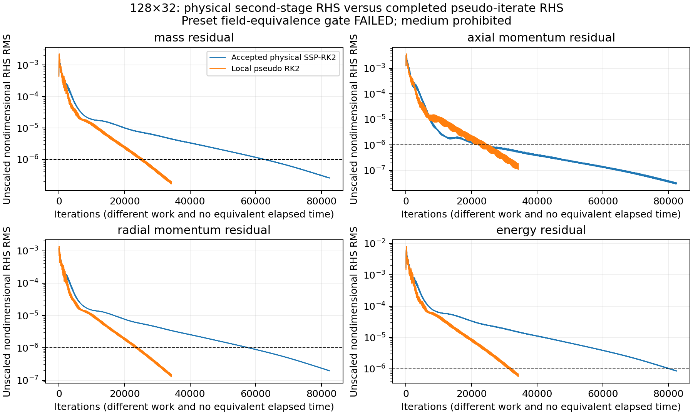
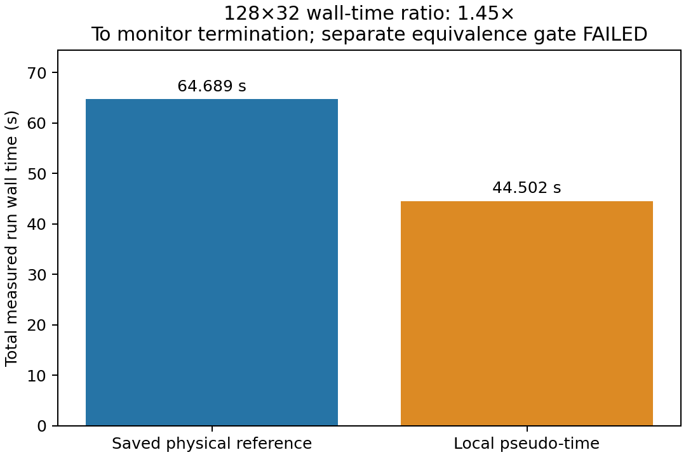

# V1.1-C2c: local pseudo-time acceleration

Development starts from `6cd80f2` on `v1.1-scientific-closure`. C2b is an accepted diagnostic milestone, not an accepted medium-grid solution.

## Preset experiment and acceptance (recorded before evaluation)

The first scientific run uses the original accepted 128×32 initial condition and its original configuration, except `steady_solver={enabled:true, local_time_step:true, cfl:0.4}` and a new output directory. CUDA FP64 and MC remain selected. The original 150,000-iteration cap, all four 1e-6 residual thresholds, minimum 5,000 iterations, sampling every 20 iterations, 2,000-iteration engineering/residual window, 5e-4 primary-observable relative-range threshold, 1e-3 interior mass-estimate gate, and 2e-3 station-spread gate remain unchanged.

Before inspecting results, root equivalence requires:

- Every residual and all original convergence-window gates pass; completed-iterate diagnostic RHS also satisfies 1e-6.
- Conservative-field Linf difference <=1e-8, componentwise nondimensionalized by the saved physical run's `(rho*, rho*a*, rho*a*, p*)`. Report L1, L2, Linf per component and across all components; norms use equal cell weights, not primitive relative errors.
- Relative differences <=1e-6 for the six primary engineering quantities (mass flow, estimated thrust, specific impulse, throat Mach, exit Mach, exit pressure). Report all other engineering quantities and station arrays too.
- Numerical boundary mass mismatch <=1e-6 and absolute difference from the accepted physical snapshot's mismatch <=1e-8. These are additional root-equivalence checks; the legacy convergence gate is not replaced.
- No unexplained fallback growth; this experiment requires zero HLLC/reconstruction fallbacks, as in the accepted reference.

Failure, instability, or a material root discrepancy stops scientific advancement. No tolerance is adjusted after examining the outcome. Only a passing coarse equivalence permits the existing C2b conservative 128×32→256×64 initializer, a 250,000-iteration medium cap, the same pseudo CFL, and unchanged monitor gates. No 512×128 run is allowed in this milestone.

## Mathematical formulation

The existing spatial operator is exactly R(U): the same HLLC/HLLE, MUSCL/MC, corrected viscous/thermal gradients, cylindrical pressure/hoop source and boundary functions. The physical-time SSP-RK2 update body and kernels are retained; a separate dispatch selects pseudo mode only when explicitly enabled. Physical mode is the default.

At pseudo iteration k, use the existing `fv_timestep` formula independently in each cell, with only the timestep CFL set to the steady configuration value:

\[
\sigma_{c,i}=\sum_{f\in\partial i} (|u_i n_x+v_i n_r|+a_i)A_f,\quad
h_{c,i}=\frac{2\,CFL_s V_i}{\sigma_{c,i}},
\]

\[
\nu_i=\frac{\mu}{\rho_i}\max\!\left(\frac43,\frac{\gamma}{Pr}\right),\quad
h_{v,i}=\frac{0.5\,CFL_s}{\nu_i[1/\Delta x_i^2+(2+skew_i^2)/\Delta r_i^2]},\quad
h_i=(h_{c,i}^{-1}+h_{v,i}^{-1})^{-1}.
\]

For zero viscosity, use h_i=h_c,i. This includes the original face geometry and diffusive restriction. Configuration restricts steady CFL to (0,0.5], the existing explicit CFL range. Positive finite h_i is checked. `local_time_step=false` uses the global minimum in pseudo mode for a controlled regression; the scientific experiment selects true.

Freeze D=diag(h_i I4) through a two-stage pseudo update:

\[
U^{(1)}=U^k+D R(U^k),\qquad
U^{k+1}=\tfrac12[U^k+U^{(1)}+D R(U^{(1)})].
\]

Reconstruct and recompute all flux/source terms at each stage. Recompute h_i at the next iteration. A third spatial evaluation reports R(U^{k+1}) itself to the unchanged convergence monitor, without multiplying by h_i. Physical mode retains its existing second-stage residual reporting. Two updates plus a final residual evaluation cost more work than one physical iteration; iteration ratios are not wall-time acceleration factors.

Every R(U)=0 state is a fixed point because both stages are unchanged. Conversely, any putative discrete RK cycle/cancellation with nonzero R(U) fails the independent final-state residual gate; small updates alone cannot establish a root. Local pseudo-time is an iteration device, not a time-accurate conservative transient: different cell step sizes do not cancel transient face updates globally. At an accepted steady state, the original finite-volume boundary/source balance remains the equation being solved. There is no residual smoothing, implicit solve, multigrid, artificial dissipation, clipping or altered spatial operator.

Each stage checks finite positive primitive states. Failure stops the run and reports `invalid_state`; no hidden retry, CFL ramp, clipping or blending is used. Configuration disallows physical end_time and physical-stage profiling in pseudo mode. This explicit local scheme is subject to its stability restrictions; the local spectral bound is not a guarantee against every nonlinear instability.

## Time and conservation semantics

`time_integration` is explicitly `physical` or `pseudo_time` in CLI, metadata, summary, performance and balance history. The compatibility `time`, `dt`, `simulated_time` and explicit `physical_simulated_time` retain physical meaning and are zero in pseudo mode. There is no single accumulated local pseudo-time. `pseudo_dt_min_normalized` and `pseudo_dt_max_normalized` report per-iteration bounds in the solver's nondimensional units; `pseudo_iterations` reports iteration count.

`mass_conservation_error` is preserved byte-for-value as an alias of `interior_inlet_exit_mass_estimate_mismatch`. The monitor continues to use that original estimate and denominator. `numerical_boundary_mass_flux_mismatch` is |m_out-m_in|/max(|m_in|,|m_out|,1e-30), from actual reconstructed numerical boundary fluxes. Initial/final four-equation budgets and sampled balances are nondimensional and per radian for axisymmetric meshes. The numerical metric is additional evidence, never a silent gate substitution.

Residual histories record actual wall elapsed time from the output writer's start alongside iteration number. Total reported run wall time measures the CLI evolution loop including convergence diagnostics/output. The saved physical reference predates added boundary-balance output, so measured acceleration includes the new mode's diagnostics overhead and is not an isolated kernel benchmark. No accepted physical trajectory is rerun.

## Measured coarse outcome

**C2c fails its preset field-equivalence gate. Scientific advancement stops before 256×64.** The optional solver reaches `steady_converged` under the original residual/engineering monitor, but that status alone does not establish the additional C2c reference-field equivalence. The bound was not relaxed and no further scientific run was launched.

| Check | Preset bound | Measured pseudo result | Outcome |
|---|---:|---:|---|
| Four residuals | each <=1e-6 | [1.98299e-7, 1.81102e-7, 1.29876e-7, 6.79200e-7] | Pass |
| Engineering stability | original window / <=5e-4 | largest primary relative range 1.19935e-8 | Pass |
| Conservative-field Linf | <=1e-8 | **2.79363e-6** | **Fail** |
| Primary engineering differences | each <=1e-6 | largest 4.76407e-9 | Pass |
| Numerical mass-flux mismatch | <=1e-6 | 2.66069e-9 | Pass |
| Numerical mismatch change from reference | <=1e-8 absolute | 1.70579e-9 | Pass |
| HLLC / reconstruction fallbacks | zero | 0 / 0 | Pass |
| Physical simulated time | remains zero | 0 s, every CSV sample has time=dt=0 | Pass |

The 101-sample unchanged acceptance window spans iterations **32,260–34,260**. Legacy/interior mass estimate is **3.518144607e-5**, below 1e-3; station spread is approximately **4.4684e-4**, below 2e-3. The independently recomputed final-state host balance gives the same four RMS residuals as the CUDA pseudo solver to roundoff.

### Conservative fields

Norms of pseudo minus accepted physical state, in the preset componentwise nondimensional scaling:

| Conserved component | L1 | L2 | Linf |
|---|---:|---:|---:|
| Mass | 5.51125e-8 | 1.13410e-7 | 8.42394e-7 |
| Axial momentum | 2.62384e-8 | 3.48651e-8 | 9.98472e-8 |
| Radial momentum | 5.25157e-8 | 9.06722e-8 | 4.43637e-7 |
| Energy | 1.86276e-7 | 3.78345e-7 | 2.79363e-6 |
| All components | 8.00356e-8 | 2.03374e-7 | 2.79363e-6 |

Each component exceeds the 1e-8 Linf bound. The largest energy and density differences are at `(i=17,j=0)`, **x/L=0.13671875**. The maximum axial-momentum difference is at `(42,0)`; radial momentum at `(20,15)`. These differences are much larger than the approximately 1.20e-14 CPU/CUDA field agreement previously measured for the accepted physical case. There is no floating-point-roundoff evidence that would justify relaxing the preset bound.

Both endpoints have nonzero residuals at their stopping tolerance. The failed comparison therefore does **not** by itself prove that two distinct exact roots of R(U)=0 exist. A residual tolerance alone does not bound state error without information about the local residual Jacobian/inverse sensitivity. The evidence supports a failure of the requested field-equivalence validation; it does not justify silently accepting the mode, retuning the stopping rule, or advancing to the medium grid.

### Engineering comparison

| Quantity | Accepted physical | Local pseudo-time | Relative difference |
|---|---:|---:|---:|
| Mass flow (kg/s) | 0.0966843852991 | 0.0966843850382 | 2.69804e-9 |
| Throat Mach | 1.00677107495 | 1.00677107155 | 3.37080e-9 |
| Exit Mach | 2.21770608295 | 2.21770607238 | 4.76407e-9 |
| Exit pressure (Pa) | 162795.239821 | 162795.239404 | 2.56042e-9 |
| Estimated thrust (N) | 171.007696256 | 171.007695674 | 3.40484e-9 |
| Specific impulse (s) | 180.359341250 | 180.359341122 | 7.06797e-10 |

The results JSON additionally reports inlet flow, exit temperature/axial velocity/area, chamber-to-exit pressure ratio, both legacy conservation quantities, and full station mass-flow and axial-Mach arrays with differences/norms. Close engineering agreement does not override the failed field criterion.

### Acceleration and residual history

| Measurement | Saved physical CUDA FP64 | Local pseudo CUDA FP64 |
|---|---:|---:|
| Iterations to original monitor termination | 82,480 | 34,260 |
| Total wall time | 64.689289 s | 44.501661 s |
| Physical simulated time | 0.00404675684 s | **0 s** |
| Spatial residual evaluations per iteration | 2 | 3 |

The **observed wall-time ratio is 1.45364×**. The iteration ratio is **2.40747×**, and is not an equivalence between physical and pseudo timesteps. One run per method was used; the saved physical wall time predates C2c diagnostics, and system/runtime variability is not characterized. This is time to the original convergence monitor's stopping point, **not a validated speedup to the preset field-equivalence target**, which failed.

Final local nondimensional step bounds are **0.00977337022–0.01589643165**, a ratio of about 1.626. No global physical time increment is assigned to those steps. The history shows faster residual decay per iteration, with oscillatory components still present; it provides no evidence of a proven infinite-time cycle.





### True boundary/global balances

Full initial/final face budgets retain convective, viscous/thermal, wall, pressure-source and hoop-stress contributions. At the final pseudo state:

| Equation | Integrated RHS | Relative global RHS | Relative assembly identity error |
|---|---:|---:|---:|
| Mass | -9.06224e-10 | 1.33034e-9 | 9.75e-18 |
| Axial momentum | +6.44497e-9 | 3.37064e-9 | 3.55e-16 |
| Radial momentum | +2.84703e-7 | 5.25242e-9 | 7.32e-16 |
| Energy | -5.14007e-9 | 2.15590e-9 | 2.27e-16 |

Relative scales and the global identity are those documented in C2b, with integrated pressure and hoop terms separately included. The radial pressure source is **27.1014545120** and hoop contribution **2.85860684e-6**. Numerical inlet/exit mass mismatch is **2.66069e-9**, compared with **9.54900e-10** for the saved physical reference. These true discrete balances are consistent; they do not erase the field difference or replace the legacy mass gate.

## Medium grid and stop condition

**256×64 was not started.** Its coarse-field prerequisite failed. Consequently there is no new medium residual floor, wall-time measurement, oscillation amplitude or comparison trajectory from C2c. The C2b medium evidence remains the latest medium result. 512×128 was not started, no accepted physical run was repeated, and no MC/spatial mathematics, smoothing, artificial dissipation or implicit method was substituted.

The next decision requires review of the failed reference-field comparison and finite-residual state accuracy. This milestone provides no authorization to revise the preset bound or continue scientific refinement.

## Validation and reproducibility

- CPU Release full CTest: **7/7 passed**.
- CUDA-enabled Release full CTest: **9/9 passed**, including local pseudo CPU/CUDA FP64 agreement and fixed-point checks, plus all existing physical-mode tests.
- New CPU pseudo-time tests: **1,076 assertions / 5 cases passed**. Coverage includes positive finite timestep, grid/CFL scaling, viscous restriction, shared residual, completed-iterate reporting, fixed-point preservation, configuration, zero physical time, metadata and legacy convergence-gate compatibility.
- Python analysis suite: **11 tests passed** in the project `.venv`, including guards that reject a changed reference and prevent a medium launch after failed equivalence. System-Python CTest skips the three optional C2b NumPy postprocessing tests; those pass in `.venv`.
- Exported coarse JSON/CSV/VTK integrity and positivity checks pass. Independent analysis validates the full convergence window and reports the failed field-equivalence gate.

The versioned [preset](steady_acceleration_c2c_preset.json) records the bounds and reference hashes established before the run. Its document hash covers the exact original prefix of this report before `## Measured coarse outcome`; it is retained unchanged. Execution metadata records the actual CLI binary, configuration and preset hashes. [Results JSON](steady_acceleration_c2c_results.json), [saved physical residual history](c2c_physical_reference_residual_history.csv) and [pseudo residual/wall history](c2c_pseudo_residual_history.csv) contain the measured evidence. Full run outputs remain preserved under `runs/steady-acceleration-c2c/coarse-128x32/`.

Build and validate with the existing project-local toolchain/dependencies:

```sh
cmake --build build-cpu -j6
cmake --build build -j6
ctest --test-dir build-cpu --output-on-failure
ctest --test-dir build --output-on-failure
.venv/bin/python -m unittest discover -s tests/analysis -v
```

The recorded execution used:

```sh
./build/astraflow_residual_probe balance \
  runs/scientific-closure/128x32/attempt-001/config.json \
  runs/residual-closure-c2b/coarse-conservative.json \
  runs/steady-acceleration-c2c/reference-balance.json
.venv/bin/python scripts/run_steady_acceleration.py coarse
.venv/bin/python scripts/analyze_steady_acceleration.py
.venv/bin/python scripts/check_run.py runs/steady-acceleration-c2c/coarse-128x32
```

For a fresh reproduction with the same preserved source data and no existing C2c output directory, `scripts/run_steady_acceleration.py prepare` creates the exact preset/coarse configuration and evaluates the reference balance without advancing it. Preparation and execution refuse to overwrite an existing experiment. **Do not rerun the recorded scientific case to regenerate a report; invoke the analysis command alone.** The runner's `medium` action independently recomputes coarse equivalence and raises before creating or launching a medium case when the gate fails. No network access or additional dependencies are required for analysis.
